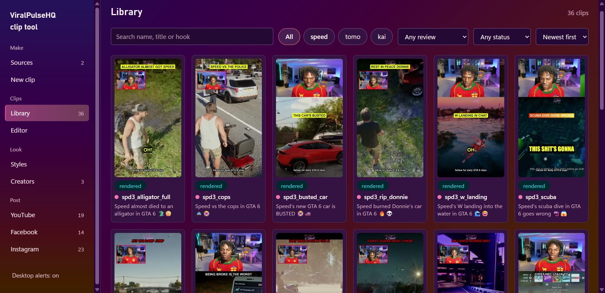
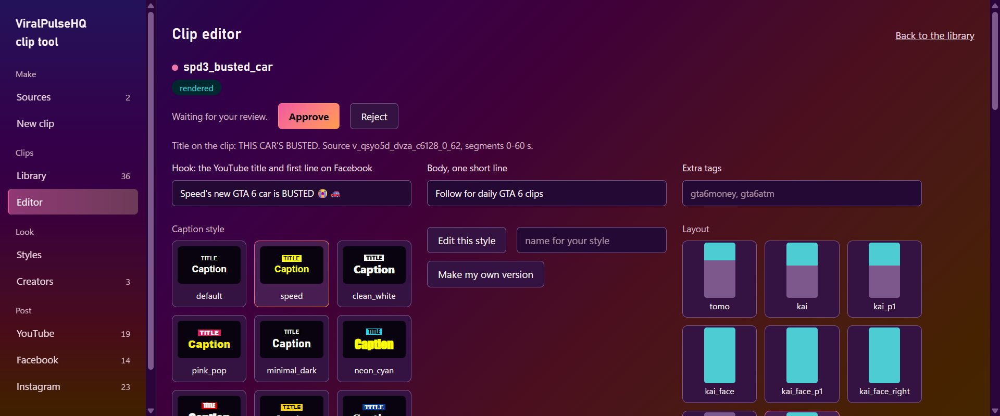
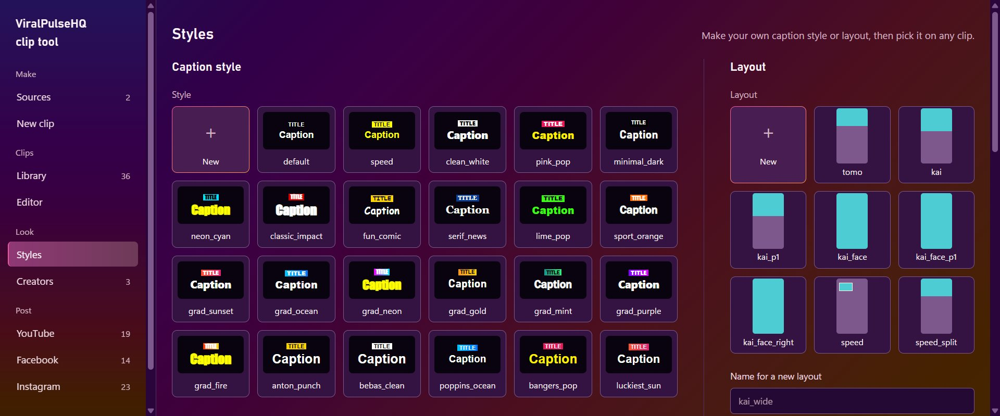
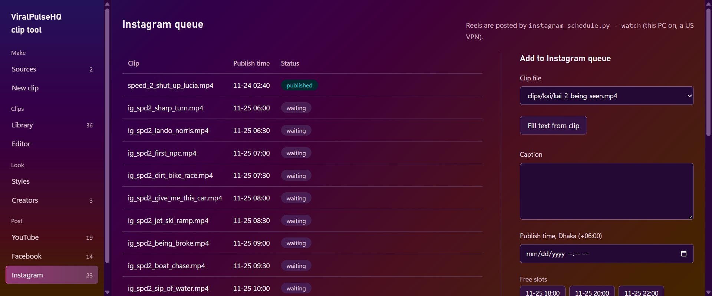
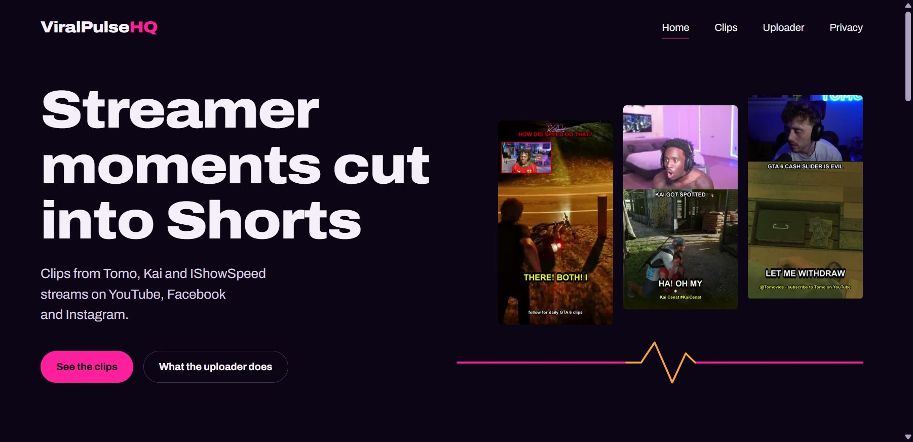

# Clip tool

Turns stream footage into short vertical clips (9:16) with a title, captions and a follow line, then schedules them on YouTube Shorts, Facebook reels and Instagram reels through the official APIs. A local web page (`scripts/clip_page.html`, served by `scripts/clip_server.py`) drives the whole flow.

## Screenshots

**Library:** every clip as a 9:16 poster with its status, filters and a review state.



**Clip editor:** approve or reject a clip, change its hook, caption style, layout, text positions and camera crop, then render it again.



**Styles:** caption styles and layouts, with separate "Save caption style" and "Save title style" buttons and live samples.



**Instagram queue:** reels waiting for their time, with free slots and a form to add one.



**Public site** (the `site/` folder): the static home page.



## Folder structure

```
.
├─ README.md
├─ requirements.txt
├─ .gitignore
├─ yunet.onnx               face-detection model used to find the streamer's camera box
├─ scripts/                 all code
│  ├─ clip_server.py        local web server (127.0.0.1 only, token in the link)
│  ├─ clip_page.html        the tool's web page (Library, Editor, Styles, Sources, queues)
│  ├─ clip_store.py         clip, style and layout storage and checks
│  ├─ make_gta_clips.py     the renderer (builds the ffmpeg command for each clip)
│  ├─ cut.py, sources.py, scan_windows.py, peaks.py, detect.py, speech_spans.py
│  │                        find and cut moments from a stream
│  ├─ camera.py             find the camera box in a frame
│  ├─ caption_timing.py, words.py, recover_words.py   caption words and timing
│  ├─ youtube_schedule.py   YouTube: upload private with a publish time
│  ├─ facebook_schedule.py  Facebook Page: scheduled reels (Meta publishes)
│  ├─ instagram_schedule.py Instagram: publishes at the set time (must be running)
│  └─ *_queue.py, queue_store.py, job_locks.py        queues and locks
├─ tests/                   one test file per script, run with: python tests/test_<name>.py
├─ site/                    the public website (static: index, clips, privacy)
├─ fonts/                   caption and title fonts (open fonts)
├─ screenshots/             the pictures shown in this README
└─ clips/
   └─ presets.json          caption styles, layouts and creator looks (the shared settings)
```

Not in the repository (listed in `.gitignore`): `footage/` and `footage_test/` (downloaded streams), rendered clips, `clips/clips.json` and the queue files (private state), `logs/`, `brand/`, `assets/`, `docs/`, and every secret file.

## Setup

1. Install Python 3.11+, then `pip install -r requirements.txt`.
2. Install `ffmpeg` and `yt-dlp`. Paths are set at the top of `scripts/live_grab.py` and in the scripts that call ffmpeg.
3. Set up the three APIs (a separate guide, `api_setup_youtube_facebook_instagram.docx`, is kept outside the repository). The scripts read their secrets from outside the project folder:
   - `D:/Tools/youtube-env/client_secret.json` and `token.json` (YouTube)
   - `D:/Tools/meta/facebook.json` with `page_id` and `page_access_token`
   - `D:/Tools/meta/instagram.json` with `ig_user_id` and `access_token`

   These paths are Windows paths written into the scripts. On another machine, change the `*_PATH` constants at the top of `youtube_schedule.py`, `facebook_schedule.py` and `instagram_schedule.py`.
4. Start the tool: `python scripts/clip_server.py`, then open the link it prints (it carries a one-time token).

## Tests

Each file in `tests/` runs on its own and exits 0 when it passes:

```
python tests/test_clip_server.py
python tests/test_make_gta_clips.py
```

## Notes

- Instagram's API cannot hold a scheduled post, so `instagram_schedule.py --watch` must be running when a reel is due. YouTube and Facebook schedule on their side.
- Never commit a token, a client secret or an app secret. If one leaks, revoke it first.
